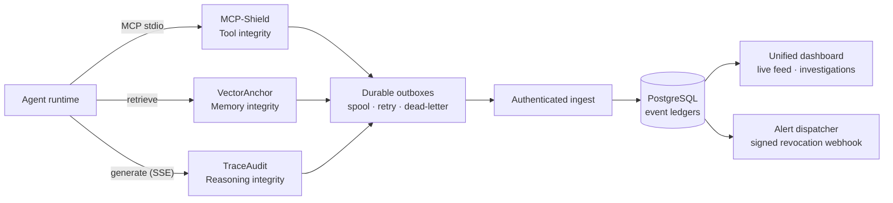

<div align="center">

<h1>PROJECT BLACK MONOLITH</h1>

<p><strong>Defense-in-depth security middleware for autonomous AI agents.</strong></p>
<p>Protect what agents call, remember, and reason about.</p>

[](https://github.com/yuno7777/project-black-monolith/actions/workflows/ci.yml)
[](LICENSE)
[](mcp-shield/)
[](vector-anchor/)
[](dashboard/)
[](supabase/)
[](https://github.com/yuno7777/project-black-monolith/actions/workflows/codeql.yml)
[](EVALUATION.md)

<br />

[What this is](#what-this-is) · [Try it](#try-it) · [Put your own agent behind it](#put-your-own-agent-behind-it) ·
[AI agent setup](#let-your-ai-agent-set-it-up-for-you) ·
[What you saw](#what-you-saw) · [How it works](#how-it-works) · [How well it works](#how-well-it-works) ·
[If it breaks](#if-it-breaks) · [What this is not](#what-this-is-not) · [Go deeper](#go-deeper)

</div>

---

## What this is

An autonomous agent has three ways in, and hardening one leaves the other two open.

- Its **tools** can change after approval.
- Its **memory** can be seeded with pages built to match every question.
- Its **reasoning** can drift off-distribution, or expose a secret mid-answer.

Black Monolith puts one independent control on each, plus a dashboard that keeps
the record of what they found. The modules share no code. They agree only on one
event format, so a single console can show one agent session being hit from
three directions at once.

> [!NOTE]
> This is defensive research tooling. Every attack artifact in this repository
> is a local, synthetic detection fixture. It does not target live systems,
> third parties, or real vulnerabilities, and the repository contains no real
> credentials. See [SECURITY.md](SECURITY.md).

---

## Try it

You need Docker with Compose, Bash, and `curl`. Everything runs offline: no
model download, no external vector database.

### 1. Make your local credentials

```bash
git clone https://github.com/yuno7777/project-black-monolith.git
cd project-black-monolith
bash scripts/generate_secrets.sh      # or: python scripts/generate_secrets.py
```

→ you should see: `Wrote .env with 8 random secrets (values not printed).`

Nothing is preset. Compose refuses to start if a secret is missing, so a
half-configured stack fails loudly instead of running wide open. The full
contract is in [`.env.example`](.env.example). The generated `.env` is
gitignored. (On Windows, `python` can be a Microsoft Store alias that exits with
`Python was not found` — use the full path to your interpreter.)

### 2. Start the stack

```bash
docker compose up -d --build --wait
```

→ you should see: `database`, `dashboard`, `vector-anchor`, `trace-audit` and
`mcp-shield` reported as `healthy`, `alert-dispatcher` running, and the two
one-shot setup jobs (`database-bootstrap`, `dashboard-migrator`) exited 0. The
first run builds six images and pulls a Postgres image, so give it several
minutes. Later runs take seconds.

| Service | Port | Primary interface |
| :--- | :---: | :--- |
| Dashboard | `127.0.0.1:3000` | Web UI, `POST /api/ingest`, resumable authenticated SSE |
| VectorAnchor | `127.0.0.1:8001` | `POST /retrieve` |
| TraceAudit | `127.0.0.1:8002` | `POST /generate` |
| MCP-Shield | stdio | MCP JSON-RPC proxy |
| Alert dispatcher | internal | Signs and delivers revocation alerts to your webhook |
| PostgreSQL | internal | Event, incident, session, and benchmark ledgers |

No Docker? `python scripts/run_local_demo.py` runs the same demo natively. It
needs PostgreSQL 17, Python 3.12, Node 22 and Rust 1.86 on your PATH — see
[CONTRIBUTING.md](CONTRIBUTING.md).

### 3. Run the attacks

```bash
bash run_full_demo.sh
```

→ you should see: three attack banners, then

```
  [OK]   MCP-Shield flagged the rug pull
  [OK]   VectorAnchor quarantined the bait doc
  [OK]   TraceAudit terminated on divergence
  [OK]   TraceAudit redacted the fake credential
  [OK]   the breaker revoked the shared session
  [OK]    all three layers reported under one session (3/3 modules)

DEMO PASSED — all three layers detected, every detection reached the ledger,
the cross-layer breaker revoked the compromised session, and all of it
correlates to one agent session:
  demo-<timestamp>-<id>
See the unified live feed at  http://localhost:3000
```

Those `[OK]` lines are ledger queries, not log lines. A passing run proves the
whole path: detector, disk outbox, authenticated ingest, database. A failing
run prints `DEMO FAILED — N check(s) failed`.

---

## Put your own agent behind it

The demos above fire synthetic attacks at the stack. `monolith wrap` puts
*your* agent behind it instead.

```bash
python scripts/monolith_wrap.py --claude
```

One command, and three things start happening that the agent cannot see:

- **Every MCP server it would have started is started through MCP-Shield**,
  so a tool that changes after approval is caught and — by default — handed
  back in the shape you approved.
- **VectorAnchor is added as a server it can call**, so the agent's memory is
  filtered, and the answer says how many documents were withheld. An agent
  that can see the gap knows its context is incomplete.
- **The model's traffic is routed through TraceAudit**, so a credential in the
  middle of an answer is redacted before the agent reads it.

All three are filed under one session id, which is what lets the cross-layer
breaker revoke the session when two layers independently agree on it.

When the agent exits, the launcher reads the ledger back and prints what the
run tripped:

```
  Session report
  --------------
  session    monolith-9f1c7b52-4a0e-4c1e-9a3d-2b6f8e0d5c41
  events     4
  severity  critical 0   warning 1   info 3
  layers    mcp-shield 1   trace-audit 2   vector-anchor 1
  detections 1   blocks 0   quarantines 0   revocations 0
```

The agent's own credential is forwarded upstream untouched, and the gateway
holds no key of its own. The session id is stamped onto every request the
gateway sends to the auditor, so a client cannot forge its way into another
session's ledger — and cannot opt out of its own. It is minted with 122 bits
of randomness, so anything else on the host cannot guess it either. The
correlation headers are not forwarded to the model provider: the run is
attributed at the layer that audits it, and the provider has no business
knowing which session it is serving.

**What it needs:** the stack up (`docker compose up -d --build`), and
`cargo build --release` in `mcp-shield/` so the host has the shield binary the
MCP servers are started through.

### Or set it up from the dashboard

If you would rather not assemble the commands yourself, open
<http://localhost:3000/onboarding> once the stack is up. The page checks each
layer and tells you the one thing to do next:

- whether the three layers are answering;
- whether the memory layer has anything to retrieve — and a button that loads
  the demo corpus, so there is no fixture script to run by hand;
- whether the tool layer is built on *your* machine, and the command if it is
  not;
- which sessions the ledger has seen, so you can tell at a glance that your
  agent is connected.

It also carries three ready-made prompts, one per layer, so you know what to
type into the agent to make it show up on the dashboard. No secret is ever
rendered into the page: the launcher reads the repository's own `.env`.

To watch the whole chain work with no API key and no credits:

```bash
bash scripts/run_gateway_demo.sh
```

→ you should see: `[PASS] the agent never received the credential`

---

## Let your AI agent set it up for you

Paste this into Claude Code, Cursor, Codex, or any agent with shell access. It
already knows this repo, so it can read the errors instead of guessing.

```text
Set up Project Black Monolith locally and prove the demo passes.

Repository: https://github.com/yuno7777/project-black-monolith.git

Do this, in order:
1. Clone the repo and cd into it.
2. Read README.md and CLAUDE.md before touching anything. CLAUDE.md documents
   the architecture and several invariants that will bite you if you ignore them.
3. Run `bash scripts/generate_secrets.sh` (or `python scripts/generate_secrets.py`).
   It writes a gitignored .env with 8 random secrets and refuses to overwrite
   an existing one — that is fine, continue.
4. Run `docker compose up -d --build --wait`. It builds six images and pulls a
   Postgres image; the first run takes several minutes.
5. Run `bash run_full_demo.sh`. It fires three synthetic attacks at the stack.
6. Report back:
   - the demo output, including every [OK] line and the DEMO PASSED line
   - the session id it printed
   - the dashboard URL and the MONOLITH_OPERATOR_TOKEN value from .env
   - anything that failed, with the full error text

Rules:
- Never commit .env or any secret, and never write a secret value into a file.
- If a step fails, read the error and the module's README before retrying.
- Do not modify a detector to make the demo pass. The demo must pass as-is.
- If Docker is unavailable, use `python scripts/run_local_demo.py` instead and
  say so in your report.
```

---

## What you saw

Three attacks, one per layer, and the console that shows them. Each layer
decides on its own evidence, without asking the other two.

| Scenario | Layer | What happens |
| :--- | :--- | :--- |
| A tool changed after you approved it | MCP-Shield (Rust) | Remembers the exact shape of every tool. Flags a changed shape or a hidden instruction, and by default hands the agent back the version you approved. |
| A document that matched every question | VectorAnchor (Python) | Notices which documents keep surfacing for unrelated topics. A legitimate document belongs to one topic, so one that answers everything is a plant and gets held back. |
| A secret in the middle of an answer | TraceAudit (Python) | Watches the answer as it streams. Cuts a stream that drifted far from the model's normal voice, and replaces credentials and personal data before they are shown, logged, or stored. |
| The console that shows it all | Dashboard (Next.js) | Stores every event before showing it, groups by session, and records every human decision. |

Run each attack on its own, no Docker required:

```bash
cd mcp-shield    && bash fixtures/run_demo.sh   # tool changed
cd vector-anchor && bash fixtures/run_demo.sh   # document matched every topic
cd trace-audit   && bash fixtures/run_demo.sh   # secret in the answer
```

→ you should see: `DEMO PASSED: rug pull detected, blocked in enforce mode, forwarded (with warnings) in monitor mode.`
→ you should see: `[OK]   universal-bait document quarantined (anomaly score = 4 across distinct topics)`
→ you should see: `[OK]   reasoning divergence terminated the stream early` and `[OK]   credential + email redacted in the reasoning trace`

The two Python demos start their own server on port 8001 and 8002. If the
Compose stack is already up, use `MONOLITH_VA_PORT=8011` and
`MONOLITH_TA_PORT=8012` instead.

---

## How it works

Four parts, no shared library. They talk over HTTP and stdio, and they agree on
one event format: the same JSON envelope, written to disk first and delivered
over an authenticated connection. The dashboard persists an event before
publishing it, so what you triage is what was actually captured.

The dashboard is at <http://localhost:3000>. Sign in with the
`MONOLITH_OPERATOR_TOKEN` value from your `.env`. It has four pages: the
**threat overview** (live feed, severity and per-module breakdowns), the
**investigation queue** at `/investigate` (assign, acknowledge, resolve, reopen;
every decision is appended, never edited), **operations** at `/operations`
(delivery backlog, dead letters, evidence age), and **benchmarks** at
`/benchmarks`.

Two independent layers flagging the same session as critical is enough to revoke
that session everywhere until an analyst restores it. The rules are in
[docs/OPERATIONS.md](docs/OPERATIONS.md). A revocation can also be pushed to your
own webhook, signed, by the alert dispatcher. For a local demo with no sign-in,
set `MONOLITH_DISABLE_AUTH=true` in `.env` and restart the stack. Local
convenience, not a production setting.

<details>
<summary><strong>How the pieces are wired</strong></summary>



The envelope's exact fields are versioned in
[`contracts/schemas/`](contracts/schemas/). `tenant_id + agent_id + session_id`
is the cross-layer correlation boundary.

</details>

<details>
<summary><strong>Credential mediation (Secret Boundary)</strong></summary>

An opt-in mode where the agent never holds a real credential. It calls a
policy-bound tool; the proxy resolves the secret, injects it into the outbound
HTTPS request internally, and returns a sanitized body.

```bash
cd mcp-shield && bash fixtures/run_secret_boundary_demo.sh
```

→ you should see: `DEMO PASSED: the boundary shadowed the impostor, intercepted the call locally, refused the metadata destination, and leaked no credential.`

See [docs/SECRET_BOUNDARY.md](docs/SECRET_BOUNDARY.md).

</details>

---

## How well it works

Each detector is scored against a labelled, deterministic corpus and stored as
a confusion matrix.

| Module · detector | Caught | False alarms | F1 |
| :--- | ---: | ---: | ---: |
| VectorAnchor · frequency anomaly | 75% | 0% | 0.857 |
| TraceAudit · reasoning divergence | 100% | 0% | 1.000 |
| TraceAudit · PII scanner | 100% | 0% | 1.000 |
| MCP-Shield · description sanitizer | 71.4% | 0% | 0.833 |
| MCP-Shield · schema fingerprint | 100% | 0% | 1.000 |

The imperfect numbers are intentional. The corpus keeps one subtle bait document
the frequency detector misses and some novel phrasing the sanitizer does not
recognise, so the misses count instead of being smoothed away. The fingerprint
score is exact by construction, not a tuned accuracy claim.

> [!CAUTION]
> These are small, synthetic, offline fixtures for reproducible engineering
> evaluation, not production-representative traffic and not a claim of field
> accuracy. Real deployments must recalibrate against their own data.

Overhead is small: about 0.13 ms to analyse a 20-tool list, 0.78 ms to audit a
60-token reply, and 0.44 ms per retrieval. With the stack running, recompute
and upload the scorecards:

```bash
bash scripts/run_benchmarks.sh
```

→ you should see: `vector-anchor: scored`, `trace-audit: scored`, `mcp-shield: scored`, then `201 {"recorded":5,...}`.

---

## If it breaks

| What you see | What to do |
| :--- | :--- |
| `error: services are not all healthy` | The stack is not up. Run `docker compose up -d --build --wait`, then `docker compose ps` to find the failing service. |
| `Python was not found` from the secrets script | On Windows `python` can be a Microsoft Store alias. Use the full path to your interpreter. |
| `Refusing to overwrite .env` | You already have one. Add `--force` to regenerate it. |
| `DEMO FAILED — N check(s) failed` | The failing `[FAIL]` line names the missing event. That module's dashboard log has the reason. |
| Sign-in rejected | The console wants the raw value of `MONOLITH_OPERATOR_TOKEN`, without the variable name. |
| `port is already allocated` | The two Python demos need 8001 and 8002. Use `MONOLITH_VA_PORT=8011` and `MONOLITH_TA_PORT=8012`, or stop the Compose stack. |

To wipe the demo state and the events it produced, run
`bash scripts/reset_demo_state.sh`. For a completely fresh start, including the
database volume, `docker compose down -v`.

---

## What this is not

- The corpora are synthetic and intentionally small.
- Pattern matching is predictable but incomplete. Clever phrasing can slip past it.
- VectorAnchor uses a simple offline word-matching embedder for the demo. A real deployment should recalibrate.
- MCP-Shield speaks line-delimited stdio and MCP Streamable HTTP POST responses. It does not open the optional standalone GET SSE channel.
- This is layered detection on three specific layers. It is not an agent sandbox, and it does not replace model, network, or host isolation.

Detection modules hold a per-module bearer token and can write only their own
events. Operators hold a role-scoped session for one tenant. The dashboard runs
as a restricted database role that cannot rewrite stored evidence. The
agent-facing `/retrieve` and `/generate` endpoints expect a trusted service
network, not end-user login. Scope and disclosure: [SECURITY.md](SECURITY.md).
Full model: [docs/IDENTITY_AND_ACCESS.md](docs/IDENTITY_AND_ACCESS.md).

---

## Go deeper

Each part is independently runnable and has its own guide: [MCP-Shield](mcp-shield/README.md) · [VectorAnchor](vector-anchor/README.md) · [TraceAudit](trace-audit/README.md) · [Dashboard](dashboard/README.md) · [Secret Boundary](crates/pbm-secret-boundary/README.md).

- [EVALUATION.md](EVALUATION.md) — calibration, accuracy, false positives, known evasions, overhead
- [CONTRIBUTING.md](CONTRIBUTING.md) — local setup, ground rules, commit conventions
- [docs/OPERATIONS.md](docs/OPERATIONS.md) — health signals, evidence export, retention, response checklist
- [docs/SECRET_BOUNDARY.md](docs/SECRET_BOUNDARY.md) — credential mediation for agent tool calls
- [docs/EVALUATION_AND_AGENT.md](docs/EVALUATION_AND_AGENT.md) — held-out benchmark profile and the protected note agent

Run every live-stack contract check:

```bash
bash scripts/run_all_verifications.sh
```

→ you should see: five scripts printing `RESULT: N passed, 0 failed`, one printing
`ALL RECOVERY CHECKS PASSED`, then `ALL VERIFICATION SCRIPTS COMPLETED`.

---

## Contributing and license

Contributions are welcome. Start with [CONTRIBUTING.md](CONTRIBUTING.md), keep
the shared event contract backward-compatible, and include an independent test
for any new security claim.

Released under the [MIT License](LICENSE). Copyright © 2026 Sleepers Research.
Originally developed under the working name AEOS Guard for a B.E. final-year
submission. The MCP-Shield, VectorAnchor, and TraceAudit module names are
unchanged.
